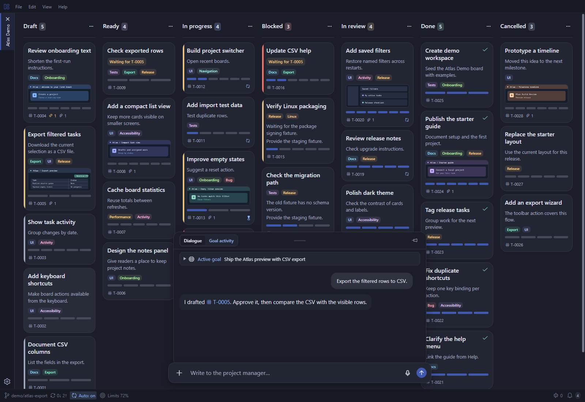

<h1 align="center">AI Taskboard</h1>
<p align="center"><strong>A local task board for coding agents and the people reviewing their work.</strong></p>
<p align="center">English · <a href="README.ru.md">Русский</a></p>
<hr>
<p align="center">
  <a href="https://github.com/edwardgushchin/AI-Taskboard/blob/main/package.json"></a>
  <a href="LICENSE"></a>
  <a href="https://github.com/edwardgushchin/AI-Taskboard/releases"></a>
</p>
<p align="center">
  <a href="https://github.com/edwardgushchin/AI-Taskboard/commits/main/"></a>
  <a href="https://github.com/edwardgushchin/AI-Taskboard/actions/workflows/ci.yml?query=branch%3Amain"></a>
</p>
<p align="center">
  <a href="https://github.com/edwardgushchin/AI-Taskboard/releases"><strong>Download alpha</strong></a> ·
  <a href="release-notes/v0.1.4-alpha.md">0.1.4-alpha release notes</a> ·
  <a href="#quick-start">Quick start</a> ·
  <a href="#features">Features</a> ·
  <a href="#workflow">Workflow</a> ·
  <a href="#platforms">Platforms</a> ·
  <a href="#documentation">Documentation</a> ·
  <a href="#contributing">Contribute</a>
</p>

<p align="center">⭐ <a href="https://github.com/edwardgushchin/AI-Taskboard">Star us on GitHub</a> - it motivates us a lot!</p>



AI Taskboard brings a Kanban board, agent chats and Git review into one Electron app. Describe a change to the project manager, approve a task, and let an executor work in a separate Git worktree. Review the result before it enters your target branch. For personal tasks, create a manual board.

<a id="features"></a>
## Features

- **Tasks that survive a chat.** Cards keep requirements, acceptance criteria, history, the latest result and the next step.
- **Manager, executor and reviewer.** Discuss the project, run tasks and inspect submissions in the same app. Review modes let a human, the project manager or a separate reviewer take part in review.
- **Isolated Git work.** Each Git task gets its own branch and worktree. Submission records a commit; acceptance integrates the reviewed result into the chosen target branch.
- **A local board shared with agents.** The app and agents use the same CLI and project `.tasks` storage. Non-Git tasks use an assigned directory and can submit artifacts without a commit.
- **Several projects in view.** Project tabs, separate windows, column filters, English and Russian UI, and built-in themes.
- **Auto mode.** The board starts eligible approved tasks when Auto mode is on. Independent review is queued in the applicable review modes even when Auto mode is off. You can reorder or pause the run queue, or hold individual tasks. [Auto mode and queue controls](docs/reference/board.md#управление-автоматической-очередью) (Russian).
- **Iterative goals.** Enable iterative execution in the Auto mode panel for an active goal. When Auto mode is on, the manager runs short turns as the queue needs work, when a question arrives, or according to the interval and event rules you configure. You can edit the active goal from manager Dialogue. [Goal settings](docs/reference/board.md#управление-автоматической-очередью) (Russian).

<a id="workflow"></a>
## From request to merged change

| Step | What happens |
| --- | --- |
| 1. Discuss | Tell the project manager what you want. A draft captures the problem and verifiable acceptance criteria. |
| 2. Approve and start | Approve the draft. Start the executor from the card, or let auto mode start eligible work. For a Git task, the board assigns a branch and worktree. |
| 3. Execute | The agent changes files, runs checks and records progress. A blocker includes the condition needed to continue. |
| 4. Review | A submission includes a diff, checks and limitations. Return it with feedback when changes are needed. |
| 5. Accept | In Human and Review + human modes, you accept the result. The board creates or verifies the acceptance commit in the target branch. Conflicts require resolution before acceptance. |

<a id="quick-start"></a>
## Quick start

### Install a packaged build

Open [Releases](https://github.com/edwardgushchin/AI-Taskboard/releases), expand **Assets** on the release you want, and select the [package for your OS and architecture](#platforms). Compare its SHA-256 with `SHA256SUMS` from the same release using the commands in the release notes. The desktop package includes the CLI and its Node.js runtime.

### Run from source

Install Node.js **24.12.0 or newer** and npm. Install Git **2.38 or newer** to clone the repository and work on Git tasks.

```sh
git clone https://github.com/edwardgushchin/AI-Taskboard.git
cd AI-Taskboard
npm ci
npm start
```

### Run your first task

1. For Git tasks, install Git 2.38 or newer. To run agents, install Codex and sign in. For ChatGPT sign-in, run:

   ```sh
   codex login
   ```

2. Open a project folder and choose **Create board** if needed. Select **Board for agents**. AI Taskboard detects Codex automatically. To select it manually, use **Settings → Codex model provider → Choose executable…**.
3. Describe a change to the manager, approve its draft and start the executor from the card.
4. Inspect the submitted diff and checks. In Human mode, choose **Accept** when the result is ready. In Review + human mode, accept it after independent approval.

See the [first-task tutorial](docs/tutorials/first-task.md) and [setup guide](docs/how-to/setup.md) (Russian). The setup guide also covers the API-key option in the current source tree.

## Platforms

Native CI builds and checks packages on x64 and ARM64 for all three platforms. The public alpha includes these formats.

| Platform | Public alpha packages |
| --- | --- |
| Windows | Run the NSIS installer (`.exe`). The alpha installer is unsigned. |
| Linux | Install the `.deb` on Debian or Ubuntu, or the `.rpm` on an RPM-based distribution. |
| macOS | Unpack the `.zip` and open the application. The alpha app uses an ad-hoc signature and has no notarization. |

See the [packaging and signing guide](docs/how-to/development.md#поставка) (Russian) and [Native CI results](https://github.com/edwardgushchin/AI-Taskboard/actions/workflows/ci.yml?query=branch%3Amain).

## Data and boundaries

Cards and board state live in the project's local **`.tasks`** directory, outside Git history. Back it up separately from source commits. Git worktrees isolate task changes, but acceptance still depends on the target branch and Git checks. Agent execution uses the configured provider's permissions and limits.

AI Taskboard uses Codex as its model provider.

<a id="license"></a>
## License

Copyright (c) 2026 Eduard Gushchin. AI Taskboard's own code and documentation
are available under the [MIT License](LICENSE), which permits commercial use.
Include the copyright and permission notices when distributing copies or
substantial portions.

Third-party components retain their own licenses and attribution. See
[NOTICE](NOTICE) and [Third-party notices](THIRD_PARTY_NOTICES.md).
Previously published versions retain their original license terms.

Installed desktop applications include these project terms in
`resources/licenses` (`Contents/Resources/licenses` on macOS). Vendor and
dependency licenses remain in `resources/app.asar`; Electron and Chromium
notices ship with the runtime. The CLI directory includes `LICENSE`, `NOTICE`,
this README, `THIRD_PARTY_NOTICES.md`, and `THIRD-PARTY-NOTICES.txt`.
Distribute them with the executable.
CLI builds download the license for the exact build-time Node.js version
from the official Node.js repository and include it with the fflate and semver licenses.

<a id="documentation"></a>
## Documentation

- [First-task tutorial](docs/tutorials/first-task.md) (Russian)
- [Installation and settings](docs/how-to/setup.md) (Russian)
- [Documentation index](docs/README.md) (Russian)
- [Development and packaging](docs/development.md)

<a id="issues"></a>
## Report a problem or suggest a change

[Search existing issues](https://github.com/edwardgushchin/AI-Taskboard/issues) before opening one. Choose [Bug report](https://github.com/edwardgushchin/AI-Taskboard/issues/new?template=bug.yml) for a reproducible problem or [Feature request](https://github.com/edwardgushchin/AI-Taskboard/issues/new?template=feature.yml) for a proposed change. Include the app version, platform and steps or use case. Remove private data from logs and screenshots.

<a id="contributing"></a>
## Contributing

Read the [contributing guide](CONTRIBUTING.md#english) and [code of conduct](CODE_OF_CONDUCT.md#english) before opening a pull request. Use the [pull request template](.github/pull_request_template.md) to describe the change and checks.

## Security

Follow the [security policy](SECURITY.md#english) to report a vulnerability privately.

## Accessibility

See the [accessibility statement](ACCESSIBILITY.md#english) for available controls and how to report barriers.
