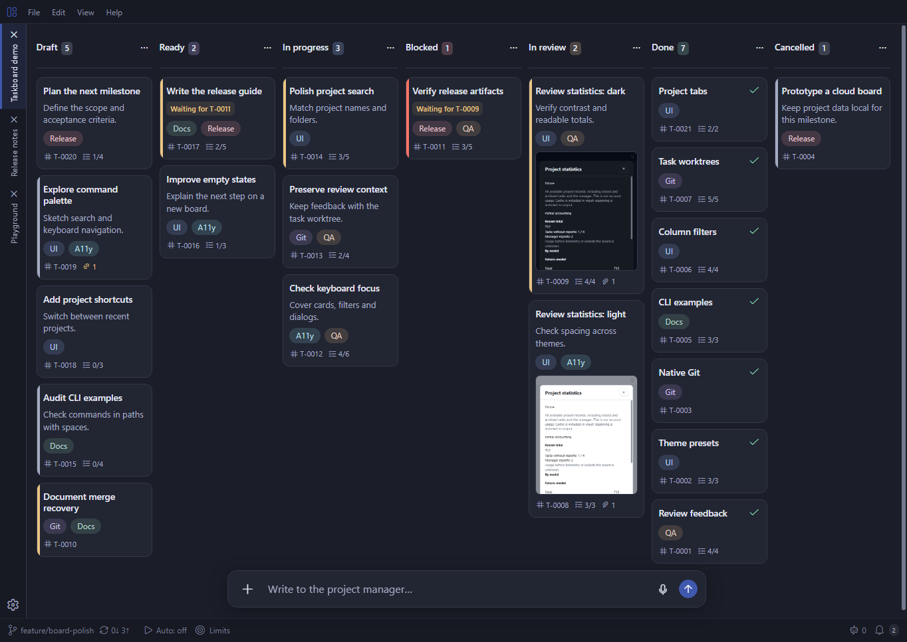
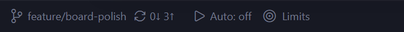

<h1 align="center">AI Taskboard</h1>
<p align="center"><strong>Локальная доска задач для coding-агентов и тех, кто проверяет их работу.</strong></p>
<p align="center"><a href="README.md">English</a> · Русский</p>
<p align="center"><a href="#features">Возможности</a> · <a href="#workflow">Цикл работы</a> · <a href="#quick-start">Быстрый старт</a> · <a href="#platforms">Платформы</a> · <a href="#documentation">Документация</a> · <a href="#license">Лицензия</a></p>



*Настоящий интерфейс приложения с открытыми демонстрационными данными. На снимке нет сеанса модели или частной переписки.*



*Git-панель того же окна при масштабе 150%: `feature/board-polish`, три локальных коммита впереди `origin`.*

AI Taskboard объединяет Kanban-доску, чаты агентов и проверку Git-изменений в приложении Electron. Опишите изменение менеджеру проекта, утвердите задачу и запустите исполнителя в отдельном Git worktree. Проверьте результат перед его слиянием с целевой веткой.

**Ранняя разработка:** первый срез рассчитан на Windows x64. Публичных установщиков пока нет; ниже описан запуск из исходников. Установщики появятся в разделе [Releases](https://github.com/edwardgushchin/AI-Taskboard/releases) после публикации.

<a id="features"></a>
## Возможности

- **Задачи сохраняются между чатами.** В карточке остаются требования, критерии приёмки, история, последний результат и следующий шаг.
- **Менеджер, исполнитель и ревьюер.** Обсуждайте проект, запускайте задачи и проверяйте сдачи в одном приложении. В проверке может участвовать человек, менеджер проекта или отдельный ревьюер в зависимости от режима.
- **Отдельная рабочая копия Git.** Каждая Git-задача получает ветку и worktree. При сдаче фиксируется коммит, при приёмке проверенный результат попадает в выбранную целевую ветку.
- **Общая локальная доска.** Приложение и агенты работают через один CLI с папкой `.tasks` проекта. Задачи без Git используют назначенную папку и могут сдавать артефакты без коммита.
- **Несколько проектов.** Вкладки проектов, отдельные окна, фильтры колонок, русский и английский интерфейс, встроенные темы.

<a id="workflow"></a>
## От запроса до слияния

| Шаг | Что происходит |
| --- | --- |
| 1. Обсуждение | Расскажите менеджеру, что нужно сделать. Черновик фиксирует проблему и проверяемые критерии приёмки. |
| 2. Утверждение и запуск | Утвердите черновик и запустите исполнителя. Для Git-задачи доска назначит ветку и worktree. |
| 3. Выполнение | Агент меняет файлы, запускает проверки и сохраняет прогресс. При блокировке он указывает условие продолжения. |
| 4. Проверка | Сдача содержит diff, результаты проверок и ограничения. Если нужны правки, верните задачу с замечаниями. |
| 5. Приёмка | В режиме проверки человеком результат принимаете вы. Доска создаёт или проверяет коммит приёмки в целевой ветке. Конфликты нужно разрешить до приёмки. |

<a id="quick-start"></a>
## Быстрый старт

### Требования

- Windows x64 для текущего среза; см. [состояние платформ](#состояние-платформ).
- Node.js **24.12+**, npm и Git **2.38+** для работы с исходниками.
- Исполняемый файл Codex и вход по подписке для запуска агентов. Приложение использует **Codex App Server**; отдельный платный API-ключ доске не нужен. Действуют условия доступа и лимиты подписки.

### Запуск из исходников

```sh
git clone https://github.com/edwardgushchin/AI-Taskboard.git
cd AI-Taskboard
npm ci
npm start
```

Перед запуском агентов войдите по подписке:

```sh
codex login
```

1. Откройте папку проекта и выберите **Создать доску**, если доски ещё нет. Для описанного здесь цикла выберите **Доску для агентов**.
2. AI Taskboard обнаруживает Codex автоматически. Чтобы выбрать файл вручную, откройте **Настройки → Провайдер моделей Codex → Выбрать файл…**.
3. Опишите изменение менеджеру, утвердите его черновик и запустите исполнителя из карточки.
4. Проверьте diff и результаты проверок. В режиме проверки человеком нажмите **Принять**, когда результат готов.

В разделе **Настройки → Оформление** можно выбрать системную или встроенную тему для всех окон. Проверки исходников, примеры CLI, отладка в VS Code и сборка установщиков описаны в [руководстве разработчика](docs/development.md).

### Установка готовой сборки

Когда установщик Windows x64 будет опубликован, скачайте его из [Releases](https://github.com/edwardgushchin/AI-Taskboard/releases), запустите `ai-taskboard-0.1.0-win-x64.exe` для версии 0.1.0 и откройте AI Taskboard из меню «Пуск». Пакет содержит автономный CLI с Node.js; отдельный Node.js для этого пакета не нужен. Для Git-задач и агентов по-прежнему нужны внешние Git и Codex. Пока пакет не опубликован, его можно собрать по руководству разработчика.

<a id="platforms"></a>
## Состояние платформ

| Платформа | Что подтверждено | Поставка |
| --- | --- | --- |
| Windows x64 | В репозитории записаны проверки UI при разработке; основная платформа первого среза | Настроена сборка NSIS `.exe`; публичного выпуска пока нет |
| Windows ARM64 | Не проверена | Проверенного выпуска нет |
| Linux x64 / ARM64 | Запланированы; завершённой матрицы CI и релизов нет | Настроены цели `.deb` / `.rpm` |
| macOS x64 / ARM64 | Запланированы; завершённой матрицы CI и релизов нет | Настроена цель `.pkg`; для поставки нужны подпись и нотарификация |

Состояние сверено **2026-11-17**: задачи CI и релизов T-0100 / T-0101 остаются черновиками. Наличие конфигурации сборки не подтверждает поддержку платформы. Снимок выше получен из интерфейса при разработке на Windows и не подтверждает установку на чистой машине.

## Данные и ограничения

Карточки и состояние доски хранятся локально в папке **`.tasks`** проекта, вне истории Git. Сохраняйте её резервную копию отдельно от коммитов исходников. Git worktree изолирует изменения задачи, но приёмка зависит от состояния целевой ветки и проверок Git. При запуске агентов действуют разрешения и лимиты выбранного провайдера.

Сейчас используется провайдер моделей Codex. Интеграции с Claude Code, Cursor и другими клиентами запланированы.

<a id="license"></a>
## Лицензия и разрешение на коммерческое использование

Copyright 2026 Eduard Gushchin. Исходный код AI Taskboard доступен на условиях
неизменённой [PolyForm Noncommercial License 1.0.0](LICENSE). Проект не относится
к OSI Open Source: лицензия ограничивает коммерческое использование, что
не допускается [разделом 6 OSD](https://opensource.org/osd).

Лицензия разрешает некоммерческие цели, включая личные исследования,
эксперименты, обучение, развлечения и хобби без предполагаемого коммерческого
применения. Она также разрешает использование благотворительными организациями,
образовательными учреждениями, общественными исследовательскими организациями,
организациями общественной безопасности и здравоохранения, природоохранными
организациями и государственными учреждениями **независимо от источника
финансирования и обязательств, связанных с финансированием**. Эти исключения
входят в лицензию; краткое описание их не сужает. Законные права, в том числе
fair use, сохраняются.

Для коммерческого использования за пределами разрешённых целей заранее
запросите отдельное разрешение у **Eduard Gushchin** по адресу
**[eduardgushchin@yandex.ru](mailto:eduardgushchin@yandex.ru)**. Опишите организацию,
планируемое использование и распространение, если оно предполагается.
Разрешение, его объём и возможные условия оплаты согласуются отдельно;
отправка запроса не даёт разрешения на коммерческое использование.

При распространении копий или разрешённых модификаций включайте текст лицензии
или её URL и строку `Required Notice:` из [NOTICE](NOTICE). Сторонние компоненты
сохраняют свои лицензии и уведомления, включая Codicons (CC-BY-4.0) и Codex
Worklog (MIT). Ранее предоставленные права не отзываются.

В установленных desktop-приложениях условия проекта находятся в
`resources/licenses` (`Contents/Resources/licenses` на macOS). Лицензии vendor-компонентов
и зависимостей остаются в `resources/app.asar`; уведомления Electron и Chromium
поставляются с рантаймом. Каталог CLI содержит `LICENSE`, `NOTICE`, английский
README и `THIRD-PARTY-NOTICES.txt`; распространяйте их вместе с исполняемым файлом.
При сборке CLI лицензия точной версии Node.js, используемой для сборки,
загружается из официального репозитория Node.js и включается вместе с лицензией fflate.

<a id="documentation"></a>
## Документация и обратная связь

- [Индекс документации](docs/README.md): руководства и материалы проекта.
- [Разработка и сборка](docs/development.md) (английский): проверки, CLI, VS Code и установщики.
- [Дизайн проекта](docs/explanation/architecture.md): цикл работы, хранение, интеграция с Git и правила проверки.
- [Releases](https://github.com/edwardgushchin/AI-Taskboard/releases): готовые пакеты после публикации.
- [GitHub Issues](https://github.com/edwardgushchin/AI-Taskboard/issues): ошибки и предложения. Добавляйте шаги воспроизведения и удаляйте частные данные из логов и снимков.
